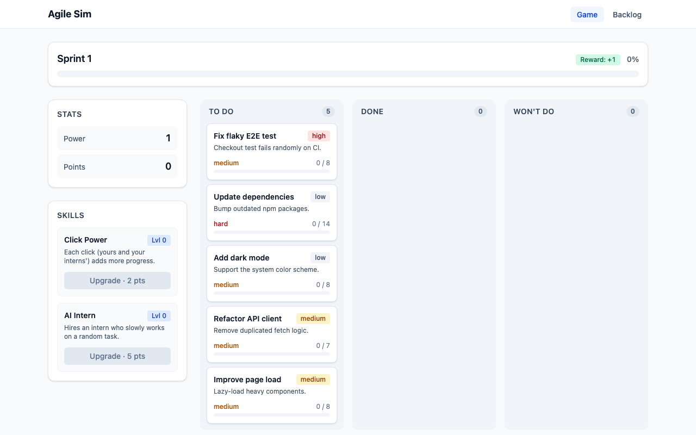
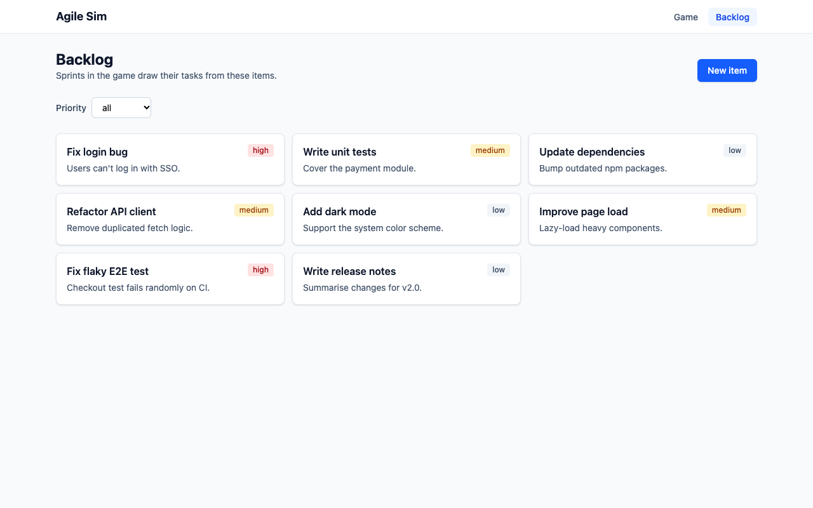
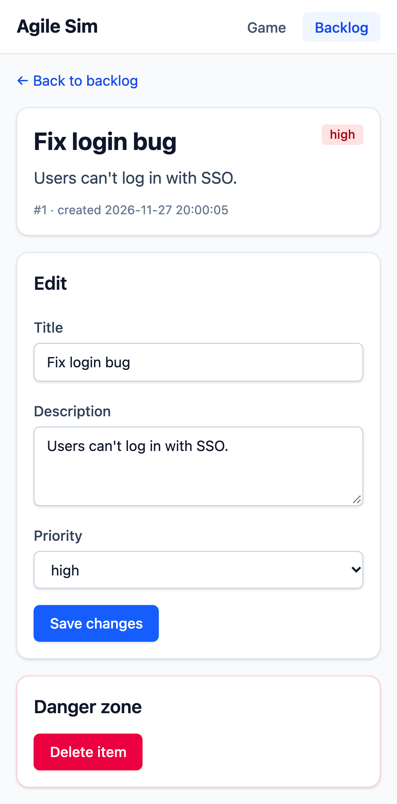

# Agile Sim

A small clicker game about sprints, with a backlog you can edit.

Each sprint takes tasks from the backlog. You click tasks to finish them, get points, and spend
them on upgrades. Tasks you give up on go to "Won't Do" and cost you points. The backlog page
lets you add, edit, delete and filter the tasks the game uses.

Made for people who want to get a feel for how sprints work.

## Frameworks

| Framework    | Version | Category    | What it does here                                                        |
| ------------ | ------- | ----------- | ------------------------------------------------------------------------ |
| React Router | 8.4     | application | pages, routing, SSR, loaders, actions, forms, REST API (resource routes) |
| Tailwind CSS | 4.3     | UI          | all styles, responsive grid, form and badge styles                       |
| Playwright   | 1.64    | tests       | API tests (`request`) and browser tests (`page`, Chromium)               |

Data is stored in SQLite (`node:sqlite`, built into Node).

## Requirements

Node.js 25 (`.nvmrc`), at least 22.5 because of `node:sqlite`.

## Running

```bash
npm install
cp .env.example .env
npm run dev        # http://localhost:5173
```

Production:

```bash
npm run build
npm start          # http://localhost:3000
```

`.env` has one variable:

- `DATABASE_PATH` – where the SQLite file is saved (default `./data/agile-sim.db`)

The database is created on first start with a few example tasks.

## Tests

```bash
npx playwright install chromium   # once
npm test
```

Tests start the app on port 5174 with a separate database (`data/test.db`).

API (`tests/api`):

- get the list
- create an item
- create with wrong data → 400
- get an item that doesn't exist → 404
- update an item
- delete an item

Browser (`tests/e2e`):

- add an item with the form
- submit an empty form → validation messages
- edit an item → "Saved."
- delete an item (with confirm)
- filter by priority
- open an item that doesn't exist → error page
- API returns 500 on save → "Saving failed" (mocked with `page.route`)
- API returns 500 on delete → "Deleting failed" (mocked)
- no network while saving → error page

Tests also run in GitHub Actions.

## API

| Method | URL                                        | Result           |
| ------ | ------------------------------------------ | ---------------- |
| GET    | `/api/backlog` (optional `?priority=high`) | 200 list         |
| POST   | `/api/backlog`                             | 201 created, 400 |
| GET    | `/api/backlog/:id`                         | 200, 404         |
| PUT    | `/api/backlog/:id`                         | 200, 400, 404    |
| DELETE | `/api/backlog/:id`                         | 204, 404         |

An item has `title` (3–80 chars), `description` (1–300 chars) and `priority` (`low`, `medium`,
`high`). `id` and `createdAt` are added by the server.

Example:

```bash
curl -X POST http://localhost:5173/api/backlog \
  -H "Content-Type: application/json" \
  -d '{"title":"Add search","description":"Search by title.","priority":"medium"}'
```

Response `201`:

```json
{
  "id": 9,
  "title": "Add search",
  "description": "Search by title.",
  "priority": "medium",
  "createdAt": "2026-11-27 20:15:42"
}
```

Wrong data gives `400`:

```json
{
  "error": "Validation failed",
  "fieldErrors": {
    "title": "Title must be 3–80 characters.",
    "description": "Description is required (max 300 characters).",
    "priority": "Priority must be low, medium or high."
  }
}
```

## Pages

- `/` – the game
- `/backlog` – list of tasks, filter by priority
- `/backlog/new` – form for a new task
- `/backlog/:id` – task details, edit and delete

## Security

`npm audit` (27.11.2026) found 10 issues (8 moderate, 2 high) in sub-dependencies like
`body-parser`, `qs` and `zod`. `npm audit fix` fixed all of them, now it shows 0.

Other things:

- the API validates data itself, the form validation is only for the user
- SQL uses parameters (`?`), no string building
- React escapes text, no `dangerouslySetInnerHTML`
- `.env` is in `.gitignore`, there are no passwords or keys in the repo

## Screenshots






